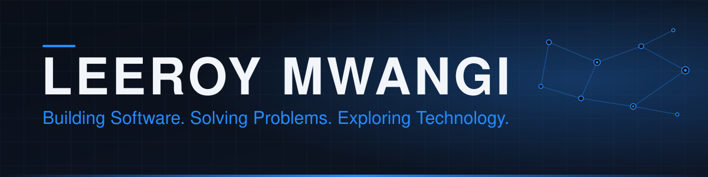
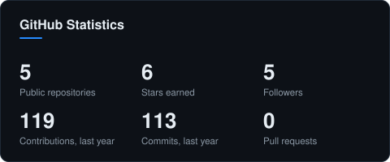
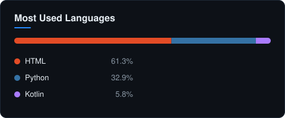
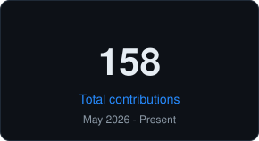
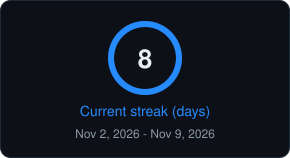
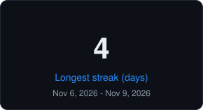
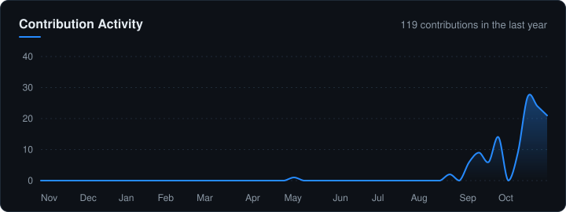

<!-- ==================== HERO ==================== -->

### Software Developer · Computer Science · IT & Networking

Building practical software, useful tools, and reliable systems.

 

## ✦ About Me

I'm a **software developer based in Nairobi, Kenya**, interested in how software, infrastructure and security come together. I enjoy taking an idea from a rough concept to something people can actually use — whether that's a web application, an Android tool or a network diagnostic utility.

<table>
<tr>
<td width="55%" valign="top">

**What I work on**

- Building full-stack web applications with React, TypeScript and Supabase.
- Developing Python tools for automation and network diagnostics.
- Exploring Android development and offline-first applications.
- Troubleshooting systems, networks and everyday IT challenges.

</td>
<td width="45%" valign="top">

**What drives me**

-  Turning ideas into working projects.
-  Learning how systems work under the hood.
-  Making security part of the build.
-  Iterating, testing and shipping better work.

</td>
</tr>
</table>

## ⚡ Current Focus

<table>
<tr>
<td width="33%" valign="top">

**01 · APPLICATIONS**

React, TypeScript and Android development. Building complete experiences from interface to data layer.

</td>
<td width="33%" valign="top">

**02 · PYTHON & AUTOMATION**

Practical command-line tools, diagnostics, scripting and cleaner workflows.

</td>
<td width="34%" valign="top">

**03 · SYSTEMS & SECURITY**

Networking, Linux, troubleshooting and security-minded engineering.

</td>
</tr>
</table>

## 🧰 Technology Stack

<b>Languages</b> 

<b>Frameworks and libraries</b> 

<b>Data and backend</b> 

<b>Tools and platforms</b> 

<b>Infrastructure and networking</b>     

## 🚀 Featured Projects

A selection of things I've designed, built and worked on. Each project solves a different kind of problem.

<table>
<tr>
<td width="50%" valign="top">

<h3>🌐 Netdiag</h3>
<strong>NETWORK DIAGNOSTICS TOOLKIT</strong> 
 

A command-line toolkit that helps investigate network issues without jumping between multiple utilities.

**What's inside**
- DNS queries with UDP/TCP fallback
- Latency, packet loss and jitter checks
- Threaded port scanning
- HTTPS timing and certificate inspection
- Shareable HTML diagnostic reports

   

</td>
<td width="50%" valign="top">

<h3>💸 Spendwise</h3>
<strong>OFFLINE M-PESA TRACKER · ANDROID</strong> 
 

An offline-first expense tracker designed to turn M-Pesa confirmations into a clearer picture of everyday spending.

**What's inside**
- Reads and records M-Pesa transactions
- Prevents duplicate entries using transaction codes
- Daily, weekly and monthly spending limits
- Local-first data storage
- Automated Android release builds

   

</td>
</tr>
<tr>
<td width="50%" valign="top">

<h3>🎫 MediaDesk</h3>
<strong>MEDIA DEPARTMENT TICKETING SYSTEM</strong> 
 

A role-based ticketing platform for submitting, assigning and tracking technical requests across a media department.

**What's inside**
- Four roles with role-aware dashboards
- PostgreSQL row-level security
- Ticket assignment and activity history
- Reports with CSV export
- File attachments and request tracking

   

</td>
<td width="50%" valign="top">

<h3>🖥️ Developer Portfolio</h3>
<strong>PERSONAL PORTFOLIO WEBSITE</strong> 
 

A responsive portfolio showcasing my work, technical interests and professional profile.

**What's inside**
- Interactive three.js hero with CSS fallback
- Dark and light themes
- CV preview and download
- Keyboard-accessible controls
- Reduced-motion support

    

</td>
</tr>
</table>

## 📊 GitHub Analytics

Stats and languages cover my public repositories. The streak cards and activity graph cover contributions since I joined GitHub. Generated from the GitHub API and refreshed daily by GitHub Actions.

## 🔨 Currently Building

- **MediaDesk** — moving V1 from local testing toward deployment.
- **Spendwise** — refining the experience and adding useful spending insights.
- **Netdiag** — exploring UDP scanning, DNSSEC checks and a web interface.
- **Next up** — deeper work in Linux systems, cybersecurity and financial technology.

## 🤝 Connect With Me

**Build with purpose. Learn by doing. Ship what matters.**

Thanks for stopping by — feel free to explore the repositories.

